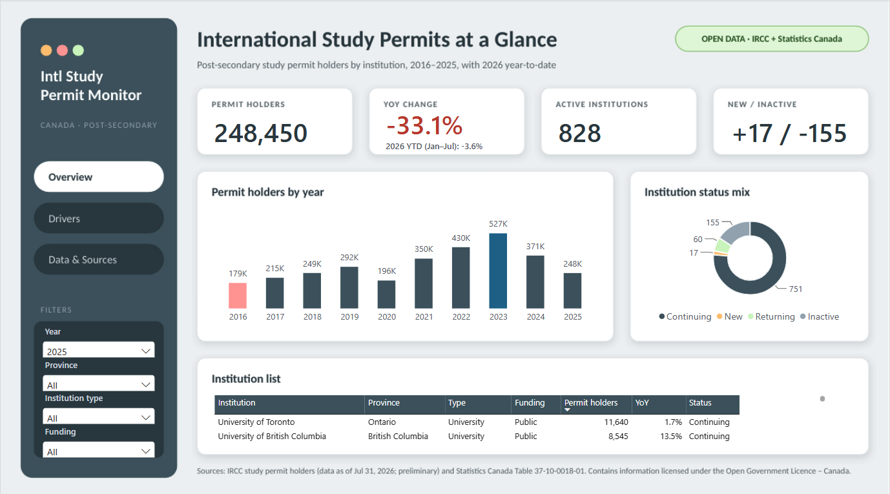
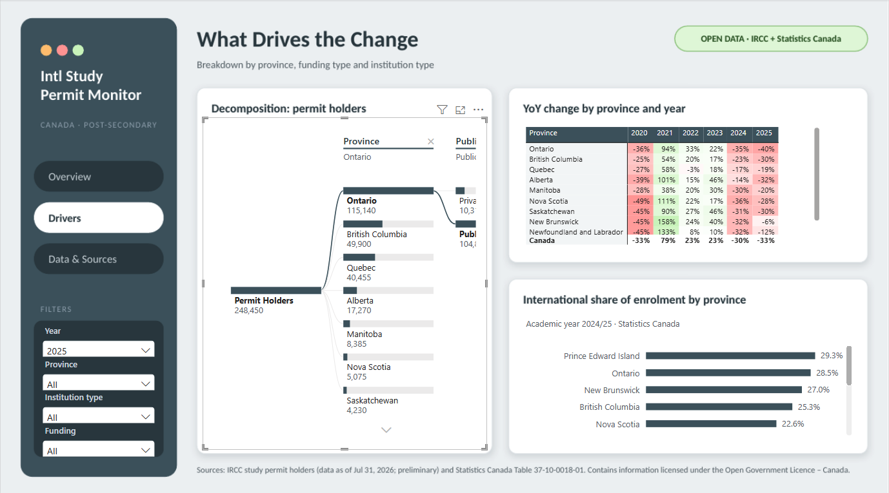
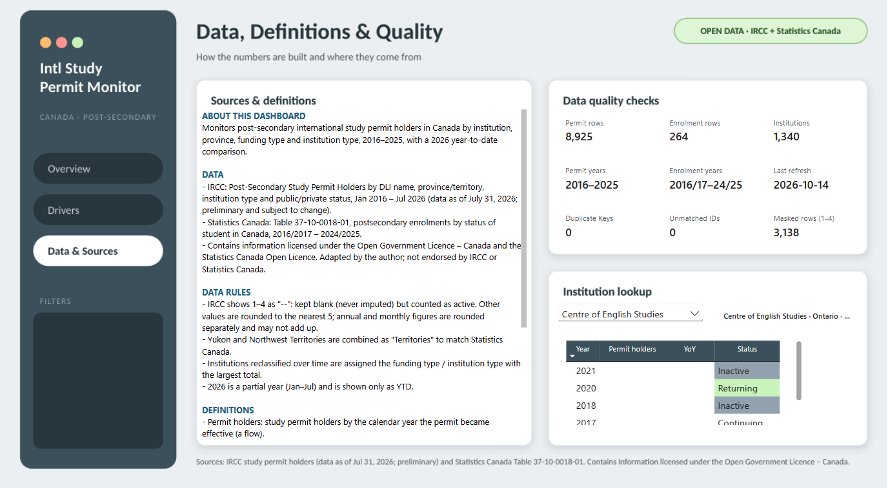
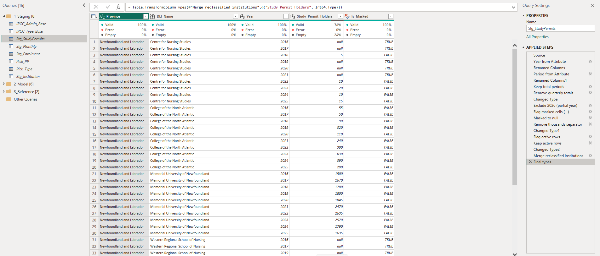
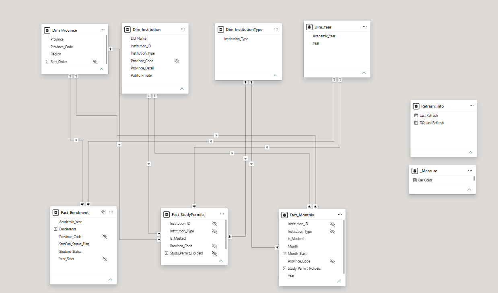

# Canada International Study Permit Monitor (Power BI)

**An end-to-end Power BI dashboard that turns raw IRCC and Statistics Canada open data into a monitoring tool for Canada's post-secondary international student market (2016–2025, plus 2026 year-to-date).**



---

## Business problem

In January 2024 Canada announced a cap on new study permits. Colleges and universities, provincial planners and education service providers need to know:

1. **How much** has the international student pipeline actually changed, and is the decline still going?
2. **Where** is it concentrated — by province, institution type and funding type?
3. **Which institutions** are new, continuing, returning or no longer receiving permit holders?
4. How do new permits (inflow) relate to **enrolment** (students already studying)?

The public files can answer these questions, but not in the form they are published: IRCC's data is a wide, multi-header Excel pivot with masked values, and enrolment lives in a separate Statistics Canada table with a different geography and calendar.

## Key insights

> All figures come from the dashboard. Change % = (later − earlier) ÷ earlier. Policy context is external and is **not** shown in the data.

**1. Permits halved from the 2023 peak — and it is not just fewer institutions.**
Post-secondary study permit holders fell from **527,290 (2023) to 248,450 (2025), −52.9%** in two years (−29.6%, then −33.1%). Active institutions fell only 17.6% (1,005 → 828); about 150 became inactive each year while only 14–17 were new. Average permit holders per active institution dropped from ~525 to ~300, so most of the decline came from **smaller intakes at institutions that remain active**. *Context:* the timing matches IRCC's January 2024 cap announcement.

**2. Colleges carry the decline — Ontario colleges alone account for about half of it.**
College permit holders fell **64%** from 2023 to 2025 (280,140 → 100,720) versus 35.5% for universities, making universities the largest institution type in 2025 (50.5% of permits, up from 36.9%). Ontario colleges dropped from 208,420 to 63,330 (**−69.6%**): 145,090 permit holders, roughly **52% of the entire national decline** of 278,840.

**3. 2026 YTD: the decline has nearly stopped — except in Ontario.**
January–July 2026 permit holders were down only **3.6%** year over year (103,230 vs 107,130). Ontario (−14.9%, −8,005) more than accounts for the national decline; **excluding Ontario, permit holders were up 7.7%**, led by Quebec (+18.1%) and Alberta (+22.7%). *Caution:* January–July excludes the August–September fall-intake peak and the data are preliminary — an early signal, not a trend.

**4. Flow vs stock: new permits fell ~30%, enrolment only ~7%.**
In 2024, newly effective study permit holders fell 29.6%, yet international enrolments fell only **6.9%** (572,964 → 533,391) between 2023/24 and 2024/25, and the international share of enrolment moved from 24.5% to 22.7%. Students already in multi-year programs cushion the drop, so the full impact is likely still ahead in the enrolment data (hypothesis — to check against the 2025/26 release).

## Dashboard

| Page | Question it answers | Main visuals |
|---|---|---|
| **Overview** | How big is the change, and who is still active? | KPI cards (permit holders, YoY + 2026 YTD, active institutions, new/inactive), permits by year, institution status mix, institution list |
| **Drivers** | Where is the change concentrated? | Decomposition tree (province → funding → institution type), YoY heatmap by province and year, international share of enrolment by province (latest academic year) |
| **Data & Sources** | Can I trust these numbers? | Sources & definitions, data-quality checks, institution lookup |

| Drivers | Data & Sources |
|---|---|
|  |  |

## Data

| Source | Content | Grain used |
|---|---|---|
| IRCC – Post-Secondary Study Permit Holders by DLI name, province/territory, institution type and public/private status (data as of July 31, 2026, preliminary) | 2 Excel files, Jan 2016 – Jul 2026 | Institution × year, institution × month |
| Statistics Canada – Table 37-10-0018-01, postsecondary enrolments by status of student in Canada | 1 CSV, 2016/2017 – 2024/2025 | Province × academic year × student status |

Raw files are in [`data/raw`](data/raw) — see [`data/README.md`](data/README.md) for sources and licence.

## How it was built

**Tools:** Power BI Desktop · Power Query (M) · DAX · custom JSON theme · page backgrounds designed in PowerPoint

### 1. Data preparation (Power Query)


- **Reshaping IRCC's pivot:** transposed the 3-row header (year / quarter / month) into one key such as `2016|Q1|Jan`, filled province and group labels that sit *below* the data, removed subtotal rows, then unpivoted 181 period columns into a long table (243,264 rows).
- **Masked values:** IRCC shows 1–4 as `--`. These are kept **blank (never imputed)** with an `Is_Masked` flag, but still counted as active institutions — otherwise 285 active institutions would disappear from 2025 (828 → 543).
- **Filter before aggregate:** zero rows are removed *before* merging duplicates, so a `--` + `0` pair stays "unknown (1–4)" instead of becoming a false 0.
- **Reclassified institutions:** institutions listed under two funding or institution types are assigned the category with the largest total (`Table.Max` over grouped rows), giving 1,340 unique institutions.
- **Geography alignment:** Yukon and Northwest Territories are combined as "Territories" through a mapping table to match Statistics Canada.
- **Reproducibility:** all file paths use a single `DataFolder` parameter; staging queries are not loaded into the model; every final query sets explicit data types.

### 2. Data model


Star schema with three fact tables and four dimensions, all single-direction one-to-many relationships:

- **Facts:** `Fact_StudyPermits` (institution × year, 8,925 rows), `Fact_Monthly` (institution × month, 62,587 rows, used for YTD), `Fact_Enrolment` (province × academic year × status, 264 rows)
- **Dimensions:** `Dim_Institution`, `Dim_Province`, `Dim_InstitutionType`, `Dim_Year` (2016–2025)
- Permits and enrolment share only the province and year dimensions; `Fact_Monthly` is intentionally not related to `Dim_Year` because it contains the partial year 2026.

### 3. Measures (DAX)
- **Institution status** — Continuing / New / Returning / Inactive — using set logic on active institution IDs (`VALUES`, `INTERSECT`, `EXCEPT`) while keeping other slicers in context:
  ```DAX
  Returning Institutions =
  VAR _Year = MAX ( Dim_Year[Year] )
  VAR _Current = VALUES ( Fact_StudyPermits[Institution_ID] )
  VAR _Prev = CALCULATETABLE ( VALUES ( Fact_StudyPermits[Institution_ID] ),
                               REMOVEFILTERS ( Dim_Year ), Dim_Year[Year] = _Year - 1 )
  VAR _Earlier = CALCULATETABLE ( VALUES ( Fact_StudyPermits[Institution_ID] ),
                                  REMOVEFILTERS ( Dim_Year ), Dim_Year[Year] < _Year - 1 )
  RETURN COUNTROWS ( INTERSECT ( EXCEPT ( _Current, _Prev ), _Earlier ) ) + 0
  ```
- **YTD comparison** that finds the latest available month automatically (no hard-coded July).
- **International share** for the latest academic year, returning blank when institution-level filters are applied because enrolment data has no institution detail.
- **Data-quality measures** (row counts, duplicate keys, unmatched IDs, masked rows) that ignore slicers.

### 4. Validation
A 15-point checklist compared dashboard values with independently calculated totals: yearly totals, YoY, active institutions, status categories (Continuing + New + Returning = Active), YTD by province, international share, funding / type / province filters, guard behaviour for unsupported filters, masked-row handling and the first data year.

## Limitations

- Permit holders (calendar year, newly effective permits) and enrolments (academic year, everyone enrolled) measure different things and are never combined on one axis.
- IRCC values of 1–4 are masked and other values are rounded to the nearest 5; annual and monthly figures are rounded separately and may not add up.
- IRCC data are preliminary and may be revised.
- International share cannot be broken down by institution, funding type or institution type.
- Small provinces and territories show volatile percentages.

## Next steps
- Refresh with August–December 2026 data to confirm or reject the YTD signal.
- Add the Statistics Canada 2025/26 enrolment release.
- Add program-level or application/approval data to explain the college decline.

## Repository structure
```
├── README.md
├── Intl_Study_Permit_Monitor.pbix
├── data/
│   ├── README.md          # sources, download dates, licence
│   └── raw/               # original IRCC and Statistics Canada files
├── images/                # screenshots used in this README
└── docs/
    └── dashboard.pdf      # static export of all pages
```

**To refresh:** open the `.pbix`, go to *Transform data › Edit parameters*, set `DataFolder` to the full path of `data/raw/` (ending with `\`), then *Refresh*.

## Attribution
Contains information licensed under the [Open Government Licence – Canada](https://open.canada.ca/en/open-government-licence-canada) and the [Statistics Canada Open Licence](https://www.statcan.gc.ca/en/reference/licence). Adapted by the author; not endorsed by Immigration, Refugees and Citizenship Canada or Statistics Canada.

---
*Author: Dylan Kang · [LinkedIn](https://www.linkedin.com/in/junhyeok-kang/)*
